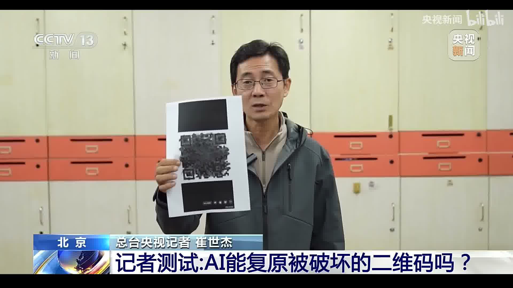
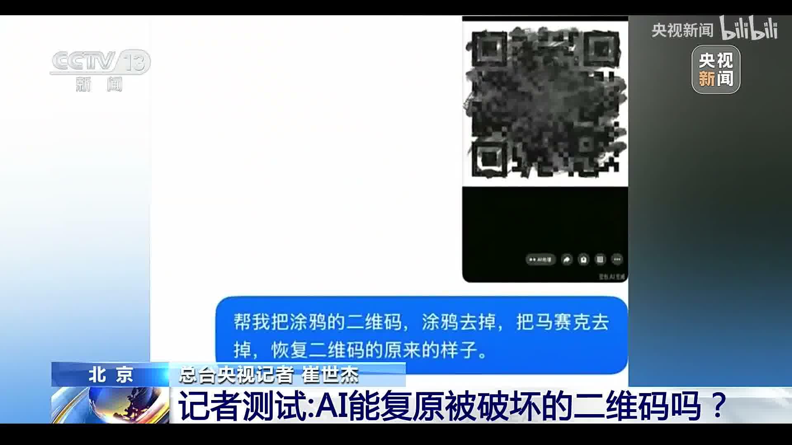
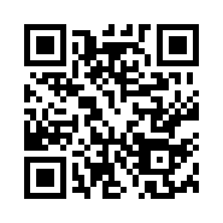

# 从涂抹的二维码中恢复网址

在央视新闻《记者测试：AI能复原被破坏的二维码吗？》节目（原片见 [`cctv-news.mp4`](cctv-news.mp4)）中，记者用黑笔大面积涂抹了一张二维码，发给 AI 测试能否复原，最终因为扫不出任何内容而得出结论：**重度涂抹的二维码，AI 无法复原**。

原始链接：https://www.bilibili.com/video/BV17FxE6jExP

| 节目画面 01:20（手持打印纸） | 节目画面 01:27（手机屏幕特写） |
| :---: | :---: |
|  |  |

**但事实上，这张二维码完全可以被 AI 唯一还原出来，原始网址就是 `https://www.baidu.com`。** 节目之所以复原失败，不是因为 AI 能力不够或信息彻底丢失，而是**记者使用了错误的方式使用 AI**。

> 本文大部分内容由AI完成，少量文本经人类修正。

---

## 1. 视频后半段说“无法恢复”，实际原因是什么？

1. **记者把数学解码问题当成了“AI 修图”问题（用错了 AI 的方式）**：
   记者给 AI 下达的提示词是*“帮我把涂鸦去掉，把马赛克去掉，恢复二维码原来的样子”*——这是在让**图像生成模型**靠视觉脑补去“画”一张像二维码的图（AI 自己在回复里都提醒了*“这是结构估算，不能保证恢复到原始二维码或可扫码”*）。而在第 2 轮测试（`00:42`）中看似修图成功，只是因为涂抹面积很小，未遮挡部分本身就没超出手机扫码器的纠错上限，跟 AI 补出来的像素毫无关系。
2. **正确使用 AI 的方式是让 AI 写代码做数学求解**：
   二维码本质上是有限域上的代数编码，而不是普通照片。正确的用法是让 AI 对视频多帧画面做对齐、提取残存的已知模块，再编写脚本联立二维码编码约束与里德-所罗门（Reed-Solomon）校验方程，不到 1 秒就能算出唯一解。
3. **节目后半段（`01:57–02:50`）的理论解释也存在误区**：
   节目称*“二维码主要数据集中在中间，四周是冗余纠错区，中间被挡就彻底丢失无法复原”*。实际上二维码的数据是从右下角自右向左蛇形排布的，且在里德-所罗门方程中，**数据模块与纠错模块在数学上完全等价**——只要边缘残存模块与已知格式先验凑够了方程数量，就能直接反解出被涂黑的数据。

---

## 2. 我们是如何把网址算出来的？

二维码中的每个黑白小方格在标准（ISO/IEC 18004 / GB/T 18284）中称为**模块（Module）**。这个二维码共有 $29 \times 29 = 841$ 个模块（Version 3）。除去定位图案、时序线、格式信息等 281 个固定**功能模块**（`-`）外，真正承载数据和纠错码的共有 **560 个模块（70 字节）**。

虽然中心有 **384 个模块（68.6%）** 被黑笔彻底涂掉（在编码学中称为**擦除，Erasure**），但我们手头有四条关键线索：

1. **规格已知**：左上、右上、左下定位符旁边的格式信息条没有被涂掉，可以直接读出它是 **Version 3、Q 级纠错、掩模 6（Mask 6）**。
2. **边缘残存 176 个已知模块**：把视频 `01:15–01:30` 之间的 375 帧画面对齐叠加后，可以从涂鸦边缘识别出 **176 个已知模块**（保存在 [`qr-matrix.json`](qr-matrix.json) 中，`1` 为黑，`0` 为白，`?` 为未知）。
3. **网址结构先验**：二维码采用 8-bit 字节模式编码网址时，除了开头的模式位、长度位和 `http://` / `https://` 前缀外，网址每个 ASCII 字符的最高比特恒为 `0`；更重要的是，**网址结束后的剩余容量会全部填满固定交替的填充字节 `0xEC` 和 `0x11`**。这意味着 272 个数据比特里其实有一大半是提前已知的。
4. **$\text{GF}(2)$ 线性方程求解**：传统里德-所罗门解码按“整字节”工作，遇到残缺字节就束手无策；但 $\text{GF}(2^8)$ 上的 RS 编码在底层比特上完全是线性的（异或运算）。把已知结构比特和画面识别出的 176 个比特联立成 **$\text{GF}(2)$ 线性方程组**，用高斯消元法就能直接解出被涂掉的字符。

---

## 3. 两个前缀后面各有多少个字符

画面中未被涂鸦遮挡、已识别出黑白的**已知模块**共有 176 个；看不清的 384 个**未知模块**标为 `?`。候选网址重新编码后，如果某个已知模块的颜色与画面识别结果相反，就记为 1 个模块误判（未知模块 `?` 填黑或填白都不计入误判）。

| 前缀 | 176 个已知模块全对 | 176 个已知模块中恰好 1 个误判 |
| --- | --- | --- |
| `http://` | 后面只能有 **14 个字符** | 后面只能有 **14 个字符** |
| `https://` | 无解 | 后面只能有 **13 个字符** |

这里数的是前缀之后的 ASCII 字符。无论是哪种情况，二维码后半段（第二个 RS 纠错块）的填充字节约束都直接将网址总长度锁死在 **21 字节**。表里的长度是二维码方程允许的长度，算出的字符仍需通过网址格式检查。

---

## 4. 最终筛出了哪些网址

| 已知模块约束条件 | 通过网址格式检查的结果 |
| --- | --- |
| 176 个已知模块全对 | 无网址（解出的 8 条字节串均为乱码） |
| 176 个已知模块中恰好 1 个误判 | 仅 **`https://www.baidu.com`** |

`www.baidu.com` 正好是 13 个字符（与前两轮测试中记者展示的百度二维码完全一致）。这个网址与画面已知模块唯一冲突的位置是 **第 22 行、第 17 列**（坐标从 1 起算）：该模块紧贴中心涂鸦的下边缘，原本是白格（`0`），被涂鸦边缘染暗后在画面里被误判成了黑格（`1`）。

仓库包含节目原始视频（[`cctv-news.mp4`](cctv-news.mp4)）、1:20 和 1:27 的两张关键帧（[`qr-keyframes/`](qr-keyframes/)）、由 375 帧对齐后得到的模块矩阵（[`qr-matrix.json`](qr-matrix.json)），以及网址枚举脚本（[`solve_qr_urls.py`](solve_qr_urls.py)）。矩阵中 `1` 表示已知黑模块，`0` 表示已知白模块，`?` 表示未知模块，`-` 表示功能模块或余位。

---

## 5. 输出重建后的二维码



程序读取 [`qr-matrix.json`](qr-matrix.json)，用解出的唯一网址重新生成二维码（沿用视频中识别出的 Version 3、Q 级纠错和掩模 6），直接保存为 [`recovered-qr.png`](recovered-qr.png)。

在仓库根目录运行：

```sh
python3 -m pip install numpy "qrcode[pil]" reedsolo
python3 solve_qr_urls.py
```
